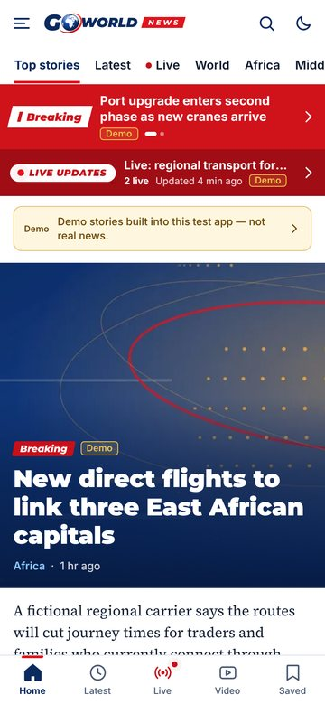
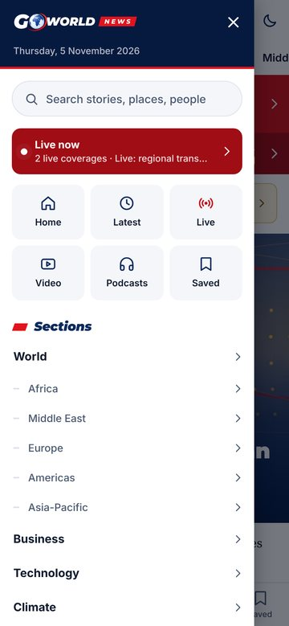
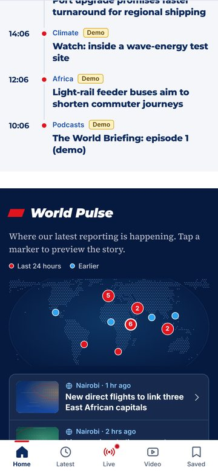
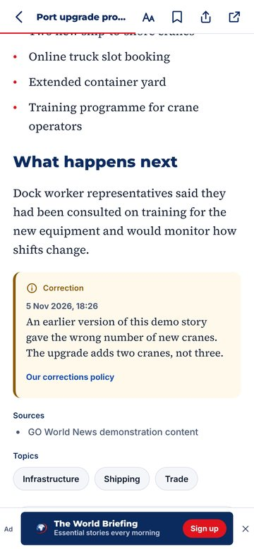

<p align="center">
  
</p>

<h3 align="center">Breaking News. Beyond Borders.</h3>

<p align="center">
  <a href="https://github.com/hudayfa203/gotest/releases/latest/download/GO-World-News.apk"><b>⬇ Download the latest Android APK</b></a>
  &nbsp;·&nbsp; <a href="https://github.com/hudayfa203/gotest/releases">All releases</a>
  &nbsp;·&nbsp; <a href="docs/INSTALL-SAMSUNG.md">Install on Samsung</a>
  &nbsp;·&nbsp; <a href="docs/TESTING.md">Test report</a>
</p>

---

# GO World News — Android app

The native GO World News app for Android (and iOS), built with **Expo SDK 58 / React Native 0.88** (new architecture,
Hermes). Screens are native views, not a website in a WebView. It reads the same API as the goworld.news website and
the newsroom dashboard.

Every push to `main` builds a release APK in GitHub Actions and installs it on an Android emulator. Each new app
version (`"version"` in `package.json`, or a `vX.Y.Z` tag) is published with its APK under
**[Releases](https://github.com/hudayfa203/gotest/releases)** — see [docs/RELEASING.md](docs/RELEASING.md).

## Install on your phone

1. On the phone, open **[GO-World-News.apk](https://github.com/hudayfa203/gotest/releases/latest/download/GO-World-News.apk)**
   (always the newest release) and download it.
2. Open the download. When Android asks, allow your browser (or *My Files*) to **install unknown apps**.
3. Tap **Install**, then **Open**.

Samsung-specific settings (Auto Blocker, Play Protect, updating, uninstalling) are covered step by step in
**[docs/INSTALL-SAMSUNG.md](docs/INSTALL-SAMSUNG.md)**. Android 7.0 or newer; 64-bit and 32-bit ARM phones.

> **Test build.** The APK on GitHub is for side-loading and testing. It is signed with a test key, not the Google Play
> key, and it has a *Settings → Content source* option. The Google Play build is produced separately
> (see [docs/RELEASING.md](docs/RELEASING.md)).

## Built-in demo stories (until the backend is online)

Real news comes from the GO World News API (`/api/v1`), which **has not been deployed to the internet yet**. So that the
app can be tried now, test APKs open with **built-in demo stories**: 25 fictional sample stories, two ongoing live
coverages (the red **BREAKING** bar rotates two alerts and **LIVE UPDATES** shows "2 live"), an archive of ended
coverage, a video and a podcast episode, with their images and media bundled in the APK. Every item carries a
**DEMO** badge and Home shows a notice that these are not real news. They were exported from the platform's demo seed,
so every screen runs exactly as it will with the real server.

When the backend is online: **Settings → Content source → Use the default server** (or type another server address).
No new APK is needed. Details: **[docs/BACKEND.md](docs/BACKEND.md)**.

## What is in the app

Version 1.2 follows the goworld.news website: the same masthead, section bar, red **BREAKING / LIVE UPDATES** bar and
heavy italic section titles, with app-only extras.

| Area | What it does |
|---|---|
| Header and menu | Menu button, logo, search and light/dark switch; a section bar (Top stories, Latest, Live, World, Africa, Middle East…) like the website's; a side menu with search, shortcuts, every section with its sub-sections, appearance, notifications, newsletters and the publisher's pages |
| Home | Red bar (rotating breaking alerts + LIVE UPDATES), lead story, top stories, the Latest timeline, **World Pulse** (a dotted world map with a marker for each story's location; tap to preview), regions, investigations, video, opinion, newsletter, most read, podcasts |
| Tabs | Home · Latest · Live (red pulse while coverage is live) · Video · Saved |
| Articles | Breadcrumb, full story with every content block, corrections, sources, topics, save for offline, share to WhatsApp / Telegram / X / Facebook / email, related coverage, more from the section, most read |
| Live Updates | Live hub, coverage timelines refreshing every 20 s, key updates, "N new updates", ended coverage and archive |
| Ads | Seven app slots managed in the dashboard (Ads): under the lead, two in the Home feed, between stories in lists, inside the article, below the article, and a closable strip at the bottom of articles. Every ad is labelled "Advertisement"; empty slots show nothing |
| Everything from the dashboard | Stories, Home order, the section bar/menu (Navigation → app menu), alerts, live coverage, ads, push notifications, About/Privacy/Terms, app links and minimum version |

<p>
  
  
  
  
</p>

<sub>Screens rendered from this source with the built-in <b>DEMO</b> stories. Real phone screenshots from each build's
emulator test are attached to every release.</sub>

## Repository layout

```
app/                     screens (Expo Router: tabs, article, live, section, author, topic, settings, sign-in)
src/api/                 API client, endpoints, offline query cache
src/components/          UI, article block renderer, live-coverage components
src/features/ src/lib/   app logic (sync, deep links, live merge logic, analytics, formatting)
src/push/ src/storage/   notifications; SecureStore / SQLite / AsyncStorage
src/state/               settings, theme, content source (test builds)
src/demo/                built-in demo stories for test builds (snapshot + bundled media)
src/features/pulse/      World Pulse map (same projection as the website)
assets/                  approved GO World News logo, app icons, splash, fonts
plugins/                 Expo config plugin: Android release signing
app.config.ts            app identity, version, permissions, deep links, API address
.github/workflows/       android-apk.yml — build, emulator test, GitHub Release
docs/                    install guide, backend/API, testing report, releasing
e2e/                     visual checks of the web preview (Playwright)
```

The `android/` project is **generated** from `app.config.ts` by `npx expo prebuild` on every build (Expo's Continuous
Native Generation), so it is not committed. Package name: **`news.goworld.app`** · URL scheme: **`goworldnews`**.

## Build it yourself

Requirements: Node 22, JDK 17, Android SDK (Android Studio). Then:

```bash
npm ci
npm run typecheck && npm test                      # TypeScript + 107 unit tests
EXPO_PUBLIC_API_URL=https://your-server/api/v1 \
EXPO_PUBLIC_ALLOW_SERVER_OVERRIDE=1 EXPO_PUBLIC_DEMO_CONTENT=default npm run build:apk
# → android/app/build/outputs/apk/release/app-release.apk
```

Development on a phone or emulator: `npx expo run:android`. More in [docs/DEVELOPMENT.md](docs/DEVELOPMENT.md).

## Configuration

| Setting | Where | Default / purpose |
|---|---|---|
| API server | repository variable `GW_API_URL`, or the *Run workflow* field | `https://goworld.news/api/v1` |
| Demo stories in test APKs | repository variable `GW_DEMO_CONTENT`: `default` / `available` / `off` | `default` (shown first) |
| Version | `package.json` version (or tag `vX.Y.Z`) → versionName; workflow run number → versionCode | `1.0.0` |
| Push notifications | variable `EAS_PROJECT_ID`, secret `GOOGLE_SERVICES_JSON_BASE64` | off until configured |
| Google Play signing | secrets `ANDROID_UPLOAD_KEYSTORE_BASE64`, `…_STORE_PASSWORD`, `…_KEY_ALIAS`, `…_KEY_PASSWORD` | test key until configured |

No secret is stored in this repository; database keys and other server credentials never ship in the app.

## Documentation

- [docs/INSTALL-SAMSUNG.md](docs/INSTALL-SAMSUNG.md) — install, update and remove the APK on a Samsung phone
- [docs/BACKEND.md](docs/BACKEND.md) — how the app connects to the GO World News API/CMS, and what is still needed
- [docs/TESTING.md](docs/TESTING.md) — what was tested, how, and known issues
- [docs/RELEASING.md](docs/RELEASING.md) — new versions, signing key, Google Play bundle, push setup
- [docs/DEVELOPMENT.md](docs/DEVELOPMENT.md) — app architecture and feature reference
- [docs/api/API.md](docs/api/API.md) · [docs/api/openapi.yaml](docs/api/openapi.yaml) — API reference (OpenAPI 3.1)
