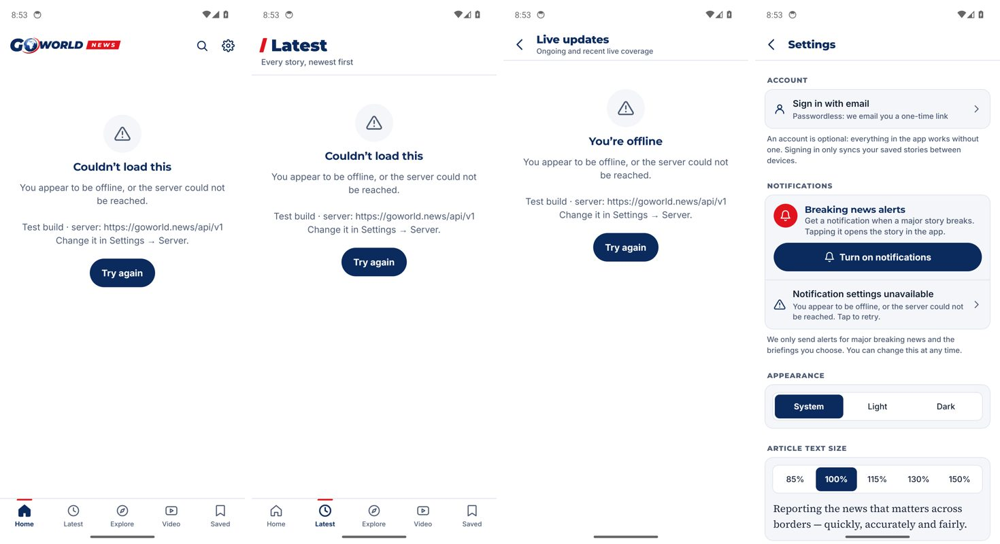
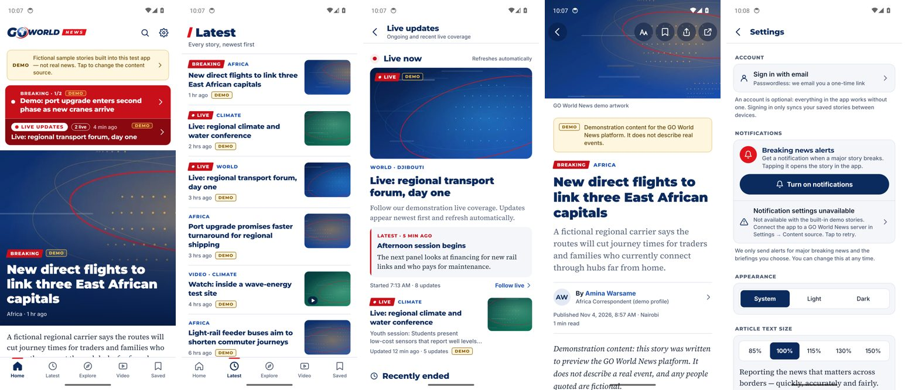

# Testing report — GO World News Android app

## On every GitHub build (automatic)

| Step | What it checks |
|---|---|
| Typecheck | strict TypeScript over the whole app, including generated typed routes |
| Unit tests (Jest, 101 tests) | API client (headers, errors, withdrawn content, timeouts, non-API answers), offline sync, deep links, article block helpers, live-coverage merge logic and badges, version gate, server setting, built-in demo stories (only demo items, current timestamps, paging/filters/search, live feeds, no fake server features) |
| Release build | `expo prebuild` + Gradle `assembleRelease` with Hermes, new architecture, arm64-v8a + armeabi-v7a + x86_64 |
| APK verification | package `news.goworld.app`, expected versionName/versionCode, APK Signature Scheme v2 valid, certificate fingerprint |
| Emulator test (Android 14, Pixel 6 profile) | installs the APK, cold-starts it, opens Home, Latest, Live Updates, an article and Settings, takes screenshots, reads the visible text, checks the process is alive and that logcat has no crash; Back button |

Each release's notes contain that build's results and its emulator screenshots.

## GitHub build results

First release, **v1.0.0** (4 November 2026, [release page](https://github.com/hudayfa203/gotest/releases/tag/v1.0.0)) —
every job passed:

| Job | Result |
|---|---|
| Typecheck + 95 unit tests | ✅ pass |
| Release APK build (Gradle, Hermes, new architecture) | ✅ `GO-World-News-v1.0.0.apk`, 91 MB, arm64-v8a + armeabi-v7a + x86_64 |
| APK checks | ✅ package `news.goworld.app`, versionName 1.0.0 / versionCode 2, minSdk 24 (Android 7.0), targetSdk 36, APK Signature Scheme v2 valid |
| Emulator test, Android 14 (API 34), 1080×2400 | ✅ installed; cold start 3.0 s to first frame (software-rendered emulator); Home, Latest, Live Updates and Settings opened via the app's deep links; process alive after each screen and after Back; **no crash, no JavaScript errors** in logcat |
| What the screens showed | GO World News logo, tab bar (Home · Latest · Explore · Video · Saved), Settings sections — and on content screens the honest *"server could not be reached"* message, because the API at `https://goworld.news/api/v1` is not online yet ([BACKEND.md](BACKEND.md)) |
| GitHub Release | ✅ APK, stable-name copy, SHA-256 file and four emulator screenshots attached |

**v1.1.0** ([release page](https://github.com/hudayfa203/gotest/releases/tag/v1.1.0)) — built-in demo stories. Every job
passed (versionCode 5, 92 MB, no crash, no JavaScript errors). On the Android 14 emulator Home showed the DEMO notice,
the red bar with **BREAKING · 1/2** and **LIVE UPDATES · 2 live · 4 min ago**, the lead story with its bundled image;
Latest, the Live hub, a full article and Settings (where notification settings correctly say they need a server)
all rendered:

Later builds: each release on the [Releases page](https://github.com/hudayfa203/gotest/releases) carries its own
results and screenshots.

**v1.0.1** ([release page](https://github.com/hudayfa203/gotest/releases/tag/v1.0.1)) — every job passed again
(versionCode 3, 91 MB, cold start 3.4 s on the emulator, no crash, no JavaScript errors). It fixes one wording issue
found in v1.0.0's emulator screenshots: screens that load from the server said *"You're offline"* even when the phone
was online and only the server was unreachable; they now say *"Couldn't reach GO World News"* in that case.

## Verified during development (before this repository)

The same app source was tested inside the full GO World News platform:

| Test | Result |
|---|---|
| Mobile unit tests (then 88; 95 now with the server setting and non-API-answer checks) | ✅ all pass |
| Android and iOS JavaScript bundles (`expo export`, Hermes bytecode) | ✅ compile |
| `expo prebuild` (package, icons, splash, scheme, App Links intent filters, permissions, release-signing plugin) | ✅ generated and checked |
| Visual checks of every screen at phone and tablet size (web preview, 41 screenshots incl. LIVE UPDATES: home entry light/dark, hub, archive, live/ended/archived coverage, new-update pill, offline saved) | ✅ |
| Cross-platform integration against the real API (dashboard publishes → website + app API + `/sync` update; live coverage start → updates → end) | ✅ 10/10 |

## Not tested yet — and why

| Not tested | Reason | How it gets tested |
|---|---|---|
| On a physical Samsung phone | No phone in the build environment | Install the release APK ([INSTALL-SAMSUNG.md](INSTALL-SAMSUNG.md)) |
| Real news content inside the APK | The backend is not deployed ([BACKEND.md](BACKEND.md)) | Deploy the backend, then *Settings → Server* or rebuild with `GW_API_URL` |
| Push notification delivery | Needs Expo project + Firebase ([RELEASING.md](RELEASING.md#push-notifications)); emulators cannot receive push | On the phone after setup |
| `https://goworld.news/…` links opening the app | Needs the website online with `assetlinks.json` | After deployment |
| Reader sign-in email | Needs the server's email service | After deployment |
| Google Play build upload | Needs your Play Console account and upload key | [RELEASING.md](RELEASING.md#google-play-when-you-are-ready) |
| iPhone build | Needs an Apple Developer account and macOS/Xcode | — |

## Known issues

1. **Demo stories, not real news, until the backend is online.** Test APKs show built-in fictional stories (labelled
   DEMO). With *Settings → Content source → Use the default server* every screen shows the honest "couldn't reach
   GO World News" state until the backend is deployed. In demo mode, sign-in, notification settings and bookmark sync
   say they are not available (they need the server); live coverage does not receive new updates.
2. **Test signing key.** GitHub APKs are signed with the React Native debug keystore (public, same for every build).
   Fine for side-loading; Play Protect warns about it; never upload such a build to Google Play. Adding the upload key
   changes the signature once (uninstall/reinstall needed).
3. **Emulator measurements are not phone measurements.** The CI emulator renders in software, so its start-up time
   and smoothness are much worse than on a real Galaxy phone.
4. **Test APK size.** It contains three CPU architectures and no code shrinking (readable crash reports for testers),
   so it is larger than the Google Play download will be.
5. **Live coverage refreshes every 20 seconds** (polling), not by push.
6. **Demo content** from the platform's demonstration data is labelled **DEMO** in the app; it must be removed from
   the production database before launch.
